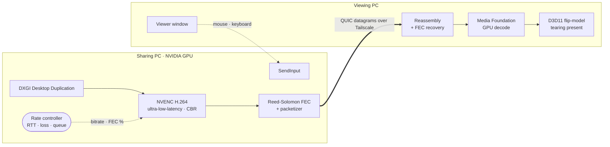

<div align="center">


# ORBIT

**Low-latency remote desktop for Windows, built on the GPU from capture to screen.**

Control your NVIDIA-powered PC from anywhere over Tailscale: smooth 60 fps, adaptive quality and
packet-loss recovery, in a single portable `.exe`.

[](https://github.com/gitsurajkr/orvia-desk/releases/latest)
[](LICENSE)


[**Download installer**](https://github.com/gitsurajkr/orvia-desk/releases/latest/download/ORBIT-Setup.exe) ·
[**Portable orbit.exe**](https://github.com/gitsurajkr/orvia-desk/releases/latest/download/orbit.exe) ·
[All releases](https://github.com/gitsurajkr/orvia-desk/releases)

</div>

---

## Highlights

|   |   |
|---|---|
| **GPU end to end** | Desktop Duplication capture → NVENC H.264 → hardware decode → tearing flip-model present. On a PC whose screen runs on the NVIDIA GPU, frames never leave video memory before encoding. |
| **Always the newest frame** | No frame queues anywhere. If the network falls behind, ORBIT waits before encoding instead of sending stale frames, so latency stays flat. |
| **Adapts to the link** | Bitrate follows round-trip time, packet loss and send-queue pressure every second. The encoder is retuned live, without a keyframe. |
| **Survives packet loss** | Every frame carries Reed-Solomon parity (10–40 %, following measured loss). Lost packets are rebuilt on arrival: no freeze, no resend. |
| **QUIC + BBR transport** | Video travels as unreliable QUIC datagrams, paced by BBR congestion control, over Tailscale's encrypted WireGuard tunnel. |
| **Runs quietly** | Lives in the notification area, can start sharing when Windows starts, and updates itself from GitHub Releases. |

## How it works



1. **Capture.** Desktop Duplication delivers a frame only when the screen changes, as a GPU texture.
2. **Encode.** NVENC (P1 preset, ultra-low-latency tuning, no B-frames, one-frame VBV) turns it into H.264 on the same GPU.
3. **Protect.** The frame is split into equal-size shards plus parity shards. The viewer can rebuild it from *any* sufficient subset, so a few lost packets cost nothing.
4. **Send.** Shards go out as QUIC datagrams, never retransmitted, so nothing old can block something new.
5. **Decode and present.** The viewer reassembles the frame, decodes it on its GPU and presents it immediately with tearing enabled (no wait for vsync).
6. **Control.** Mouse moves travel as datagrams; keys, buttons and wheel go on a reliable stream; the sharing PC injects them with `SendInput`.

## Quick start

> **You need:** two Windows 10/11 PCs signed in to the same [Tailscale](https://tailscale.com) network.
> The PC being controlled needs an **NVIDIA GPU** (for NVENC).

1. **Install** ORBIT on both PCs with the [installer](https://github.com/gitsurajkr/orvia-desk/releases/latest/download/ORBIT-Setup.exe), or just run the portable `orbit.exe`.
2. **On the PC you want to control:** open ORBIT → **SHARE** → press the big button. It shows this PC's Tailscale IP (click to copy).
3. **On the other PC:** open ORBIT → **CONNECT** → type that IP or Tailscale name → press the big button or <kbd>Enter</kbd>.

The remote screen opens in its own window. To end the session, close that window, or press **DISCONNECT** in ORBIT.

| In the viewer | |
|---|---|
| <kbd>Ctrl</kbd> + <kbd>Alt</kbd> + <kbd>Enter</kbd> | Toggle fullscreen (stays on this PC) |
| <kbd>Win</kbd>, <kbd>Alt</kbd>+<kbd>Tab</kbd>, <kbd>Ctrl</kbd>+<kbd>Esc</kbd> | Go to the remote PC while the viewer has focus |
| Title bar | Live fps, bitrate and latency |
| **VIEW ONLY** (CONNECT tab) | Watch without controlling |

> [!TIP]
> Run `tailscale status` and look at the other PC's line. `direct` means the best latency. `relay "bom"` (or another city) means traffic goes through a Tailscale relay, which adds tens of milliseconds. Being on the same Wi-Fi or having IPv6 on both networks usually gives a direct path.

## In the background

ORBIT sits in the **notification area** next to the clock:

- **Left-click** the icon to open ORBIT. **Right-click** for *Open ORBIT* / *Quit ORBIT*.
- **Hover** to see what it's doing, e.g. `ORBIT · SHARING · 100.x.y.z CONNECTED`.
- The window's **─** and **✕** buttons send ORBIT to the tray, so sharing keeps running. Quit from the tray menu.

### Share automatically after every restart

On the sharing PC, tick **START SHARING WHEN WINDOWS STARTS** in the SHARE tab. ORBIT then starts in the tray at every sign-in and begins sharing once Tailscale and the network are up. If the network drops the listener, ORBIT restarts it by itself.

Windows only lets apps capture a signed-in, unlocked desktop. For restarts with nobody at the PC, also set up:

1. **Automatic sign-in:** Microsoft's free [Autologon](https://learn.microsoft.com/sysinternals/downloads/autologon) tool (stores the password encrypted). Only do this on a PC in a place you trust.
2. **Tailscale before sign-in:** Tailscale tray icon → Preferences → **Run unattended**.
3. **No lock, no sleep:** Settings → Accounts → Sign-in options → require sign-in again → **Never**. Settings → System → Power → sleep → **Never** (turning the screen off is fine).

### Updates

ORBIT checks GitHub Releases at startup and every 30 minutes. When a new version is out, an **UPDATE** banner appears. One click downloads the installer, verifies its SHA-256, installs it and reopens ORBIT. Nothing installs without that click.

## Performance

Measured, not estimated:

| Setup | Result |
|---|---|
| Loopback, laptop with a hybrid GPU (screen on iGPU, NVENC on GTX 1650 Ti) | **12–20 ms** capture → present, including the cross-GPU copy · ~58 fps at 1080p |
| Internet, RTX 4070 Super desktop → laptop over a direct Tailscale path (~50 ms ping) | Video playback with **0 dropped frames**, adaptive bitrate settling around 11 Mbit/s |
| Loopback with one packet dropped in every 3rd frame | **0 frames lost**, **0 keyframe requests**: all losses rebuilt by FEC |

Latency is measured from capture on the sharing PC to present on the viewer, on synchronized clocks. It doesn't include the monitor's own scan-out delay.

## Reading the stats

**SHARE tab** (sharing PC), every second:

| Field | Meaning |
|---|---|
| `FPS` · `MBIT/S` | Frames and bitrate actually sent |
| `RATE x (REASON)` | Bitrate the controller allows right now, and why: `MAX`, `CLIMB`, `PROBE`, `HOLD`, `BURST`, `RTT`, `LOSS`, `QUEUE`, `NET WAIT` |
| `FEC n%` | Parity added per frame (rises with packet loss) |
| `ENCODE` | NVENC time per frame |
| `RTT` | Round-trip time to the viewer |
| `NET WAIT` | Time spent waiting for the network to drain. High values mean the link is the limit |
| `DROPPED` | Encoded frames thrown away (should stay at 0) |
| `DIRECT` · `RELAY BOM` · `PEER RELAY` | How Tailscale carries the traffic right now. A relay adds latency; Tailscale often switches to direct after a few seconds |

**Viewer title bar:** `fps (recv) | Mbit/s | latency ms avg/p95/max | DIRECT` (or `RELAY BOM`). The full line, printed when the viewer runs from a terminal, adds `decode ms`, `frame spread ms`, `rtt` and `lost · skip · keyreq · fec-fixed`. `fec-fixed` counts frames that FEC saved from being lost.

## Security

Two locks, one inside the other:

1. **Tailscale.** ORBIT accepts connections **only from Tailscale addresses** (100.64.0.0/10, fd7a:115c:a1e0::/48); anything from your LAN or the internet is refused. Traffic is encrypted by Tailscale's WireGuard tunnel, and by QUIC's TLS 1.3 on top.
2. **Pairing.** Every ORBIT install has its own ID certificate (its private key is encrypted with Windows DPAPI). The sharing PC lets in only devices on its **PAIRED DEVICES** list. Nothing is captured or controlled before that check.

How a device gets on the list, once:

- **Your own devices** (logged into the same Tailscale account as the sharing PC) pair themselves on their first connection. Turn this off in PAIRED DEVICES if other people use your Tailscale account.
- **Anyone else** needs a 6-digit code: on the sharing PC, SHARE → PAIRED DEVICES → **PAIR A NEW DEVICE**. The code is valid for 5 minutes and 5 tries, and is checked with SPAKE2, so it never travels over the network and can't be guessed offline.

**REMOVE** in PAIRED DEVICES ends that device's session at once. The viewer also remembers each PC's ID: if a different one answers at the same address, ORBIT warns before connecting (like SSH).

> [!TIP]
> Never forward UDP port 9000 on your router. You can also limit who reaches port 9000 with [Tailscale ACLs](https://tailscale.com/kb/1018/acls).

## Known limits

- One monitor at a time. No clipboard sync yet.
- Your own pointer stands in for the remote one (which is why it feels instant); it takes the remote pointer's shape: I-beam, resize arrows, hand, hidden during video.
- <kbd>Ctrl</kbd>+<kbd>Alt</kbd>+<kbd>Del</kbd> stays on the viewing PC (Windows reserves it).
- The sharing PC must stay **unlocked**: the lock screen and UAC prompts can't be captured by a normal app. ORBIT waits and resumes on unlock.
- To control apps running as administrator, run ORBIT as administrator on the sharing PC.
- On hybrid laptops used for sharing, frames are copied from the integrated GPU to the NVIDIA GPU (a few ms extra).

## Roadmap

- [ ] NVENC reference-frame invalidation: recover from heavy loss without a keyframe
- [ ] Lower resolution automatically on very slow links
- [ ] Clipboard sync and multi-monitor switching
- [ ] Lock screen and UAC capture (Windows service)

## Build from source

Requires [Rust](https://rustup.rs) (MSVC toolchain) and Visual Studio Build Tools with the *Desktop development with C++* workload.

```powershell
cargo build --release
# target\release\orbit.exe          the app (CONNECT / SHARE)
# target\release\orbit-server.exe   command-line sharing, prints stats every second
# target\release\orbit-client.exe   command-line viewer
```

```powershell
orbit-server --list                   # monitors and which GPU drives each
orbit-server --fps 120 --mbps 30      # share on UDP 9000 (Tailscale peers only)
orbit-server --bench --dump out.h264  # capture + encode only, no network
orbit-server --pair                   # also show a pairing code for a new device
orbit-client 100.x.y.z --view-only
orbit-client 100.x.y.z --code 123456  # first connection from another Tailscale account
```

Settings and recent addresses are stored in `%APPDATA%\ORBIT\orbit.cfg`; the ID certificate in `identity.bin`, paired devices in `trusted.json` and known PCs in `known_pcs.json` next to it.

## License

[MIT](LICENSE) © 2026 Suraj Kumar
