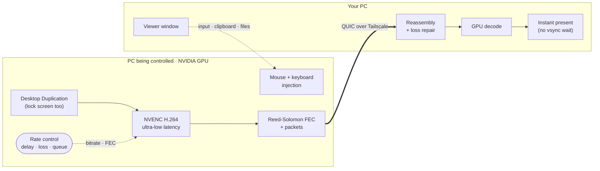

<div align="center">


# ORBIT

### Your other PC, right here. 60 fps, a few milliseconds behind.

A remote desktop for Windows that runs on the GPU from capture to screen,<br>
connects over [Tailscale](https://tailscale.com), and stays smooth when the network doesn't.

[](https://github.com/gitsurajkr/orbit/releases/latest)
[](LICENSE)


<br>

### [⬇ Download ORBIT for Windows](https://github.com/gitsurajkr/orbit/releases/latest/download/ORBIT-Setup.exe)

</div>

<br>

## ✦ What you get

<table>
<tr>
<td width="50%" valign="top">

**⚡ Fast**
- **12–20 ms** from the remote screen to yours (measured)
- GPU all the way: Desktop Duplication → NVENC → hardware decode
- Always the **newest frame**: nothing ever queues up
- Your own mouse pointer, so pointing feels instant

</td>
<td width="50%" valign="top">

**🌊 Smooth on real networks**
- Bitrate adapts every second to delay, loss and congestion
- Lost packets **rebuilt on arrival** (Reed-Solomon FEC)
- A frame lost anyway is repaired **without a blurry keyframe**
- QUIC + BBR, video before everything else

</td>
</tr>
<tr>
<td valign="top">

**🖥 Everything you need**
- Clipboard both ways: text and images
- **Send files**: drag onto the window, or copy and paste
- **Lock screen, UAC prompts, Ctrl+Alt+Del**
- Multiple monitors, Win key and Alt+Tab, live pointer shapes

</td>
<td valign="top">

**🔒 Safe by default**
- Only reachable through your Tailscale network
- Only **paired** devices get in (a 6-digit code, once)
- Own ID certificate per PC, warns if a PC's ID changes
- Lives quietly in the tray, updates itself

</td>
</tr>
</table>

<br>

## ✦ Get started

> **You need:** Windows 10 or 11 on both PCs, and an **NVIDIA GPU** in the PC you want to control.

### Your own PCs (one Gmail)

| | |
|---|---|
| **1** | Install **[Tailscale](https://tailscale.com/download/windows)** on both PCs and sign in with **the same Gmail** |
| **2** | Install **[ORBIT](https://github.com/gitsurajkr/orbit/releases/latest/download/ORBIT-Setup.exe)** on both PCs |
| **3** | On the PC to control: **SHARE** → press the big button |
| **4** | On your PC: **CONNECT** → click its name under **ONLINE** → you're in |

No codes, nothing else. Your own devices recognise each other.

<sub>Can't install on a PC (office, school)? Each release also has a portable <a href="https://github.com/gitsurajkr/orbit/releases/latest/download/orbit.exe">orbit.exe</a> that runs without installing. It can do everything except the lock screen and UAC prompts.</sub>

### A friend's PC (two Gmails)

Both of you do these steps **once**. Afterwards **either of you can control the other's PC**.

| | Both of you |
|---|---|
| **1** | Install **Tailscale** and sign in with **your own** Gmail |
| **2** | Install **ORBIT** |
| **3** | In [Tailscale's machine list](https://login.tailscale.com/admin/machines): your PC → **⋯** → **Share** → the other person's Gmail |
| **4** | Open the email from Tailscale → **Accept** |
| **5** | ORBIT → **SHARE**, and send the other person your IP |
| **6** | To control the other PC: **CONNECT** → their IP → the **6-digit code** they read you (first time only) |

> [!TIP]
> You don't need to remember this: ORBIT has it built in. **CONNECT → HOW TO CONNECT ?** walks through every step with buttons, and **SHARE → INVITE A FRIEND** copies a ready-made message to send.

<br>

## ✦ Using it

| In the viewer | |
|---|---|
| <kbd>Ctrl</kbd> + <kbd>Alt</kbd> + <kbd>Enter</kbd> | Fullscreen on / off |
| <kbd>Win</kbd> · <kbd>Alt</kbd>+<kbd>Tab</kbd> · <kbd>Ctrl</kbd>+<kbd>Esc</kbd> | Go to the remote PC |
| <kbd>Ctrl</kbd> + <kbd>Alt</kbd> + <kbd>1</kbd>…<kbd>9</kbd> | Show the remote PC's screen 1…9 |
| <kbd>Alt</kbd> + <kbd>Space</kbd> | Window menu: screens, **Send Ctrl+Alt+Del** |
| Drag files onto the window | They land in **Downloads\ORBIT** on the other PC |
| Title bar | Live fps, bitrate, latency, and **DIRECT** or **RELAY** |

**On the CONNECT tab:** *VIEW ONLY* watches without controlling. *SYNC CLIPBOARD* (on by default) lets you copy on one PC and paste on the other, including whole files from Explorer.

**On the SHARE tab:** *START ORBIT WHEN WINDOWS STARTS* brings sharing back after every restart, **before anyone signs in**, so you can sign in remotely. For a PC nobody is sitting at, also turn on Tailscale's **Run unattended** (Tailscale icon → Preferences) and set sleep to **Never**.

**In the tray:** ORBIT lives next to the clock. Left-click opens it; right-click quits. Closing the window keeps sharing running. When an update is out, an **UPDATE** button appears: one click downloads it, checks its SHA-256 and installs it.

<br>

## ✦ How it works



1. **Capture** — the screen arrives as a GPU texture, only when something changed.
2. **Encode** — NVENC turns it into H.264 on the same GPU, tuned for the lowest possible delay.
3. **Protect** — each frame gets spare repair packets, so a few lost packets cost nothing.
4. **Send** — as QUIC datagrams that are never resent, so nothing old ever blocks something new.
5. **Show** — your GPU decodes it and puts it on screen immediately.

<details>
<summary><b>Performance numbers</b></summary>
<br>

Measured, not estimated:

| Setup | Result |
|---|---|
| Loopback, hybrid-GPU laptop (screen on the iGPU, NVENC on a GTX 1650 Ti) | **12–20 ms** capture → screen, incl. the cross-GPU copy · ~58 fps at 1080p |
| Internet, RTX 4070 Super desktop → laptop, direct Tailscale path (~50 ms ping) | Video playback with **0 dropped frames**, adaptive bitrate around 11 Mbit/s |
| One packet dropped in every 3rd frame | **0 frames lost**, all rebuilt by FEC |
| One whole frame dropped every second | Repaired every time **without a keyframe**, clean picture |
| 300 MB file transfer during a stream | Video stays at 55–59 fps; the transfer only uses spare bandwidth |
| Laptop locked mid-stream | Lock screen streamed at **55–59 fps**, no interruption |

Latency is measured from capture on one PC to display on the other, with synchronised clocks, not counting the monitor's own delay.

</details>

<details>
<summary><b>Reading the stats</b></summary>
<br>

**SHARE tab**, every second:

| Field | Meaning |
|---|---|
| `FPS` · `MBIT/S` | Frames and bitrate actually sent |
| `RATE x (REASON)` | Bitrate allowed right now, and why: `MAX`, `CLIMB`, `PROBE`, `HOLD`, `BURST`, `RTT`, `LOSS`, `QUEUE`, `NET WAIT` |
| `FEC n%` | Repair data added per frame (rises with packet loss) |
| `ENCODE` · `RTT` | Encoder time per frame · round trip to the viewer |
| `NET WAIT` | Time waiting for the network; high means the link is the limit |
| `DROPPED` | Encoded frames thrown away (should stay 0) |
| `DIRECT` · `RELAY BOM` | How Tailscale carries the traffic; a relay adds latency |

**Viewer**, when run from a terminal, also prints `decode ms`, `frame spread ms`, and `lost · skip · keyreq · repair-req · fec-fixed`.

> [!TIP]
> **RELAY** in the stats means Tailscale is routing through one of its servers, which adds tens of milliseconds. Both PCs having IPv6, or being on the same network, usually gives **DIRECT**.

</details>

<details>
<summary><b>Security in detail</b></summary>
<br>

Two locks, one inside the other:

1. **Tailscale.** ORBIT only accepts connections from Tailscale addresses; anything from your LAN or the internet is refused. Traffic is encrypted by Tailscale's WireGuard tunnel, and again by QUIC's TLS 1.3.
2. **Pairing.** Every ORBIT install has its own ID certificate (private key encrypted with Windows DPAPI). A PC only lets in devices on its **PAIRED DEVICES** list; nothing is captured or controlled before that check.

How a device gets on the list, once:

- **Your own devices** (same Tailscale account) pair themselves on their first connection. Turn this off in PAIRED DEVICES if other people use your account.
- **Everyone else** needs a 6-digit code (PAIRED DEVICES → PAIR A NEW DEVICE). It's valid for 5 minutes and 5 tries, and checked with SPAKE2, so the code itself never crosses the network.

**REMOVE** ends a device's session immediately. The viewer remembers each PC's ID and warns if a different one answers at the same address.

The lock screen and UAC prompts are handled by a small Windows service (*ORBIT Remote Desktop*) that the installer sets up. It runs as SYSTEM, which Windows requires for that, keeps its keys in a folder only SYSTEM and administrators can read, and only listens while you're sharing.

Never forward UDP port 9000 on your router. To limit who on your tailnet can reach ORBIT at all, use [Tailscale ACLs](https://tailscale.com/kb/1018/acls).

</details>

<details>
<summary><b>Known limits</b></summary>
<br>

- One remote screen at a time (switch with <kbd>Ctrl</kbd>+<kbd>Alt</kbd>+<kbd>1</kbd>…<kbd>9</kbd>).
- The PC being controlled needs an NVIDIA GPU (NVENC).
- The portable `orbit.exe` can't show the lock screen or UAC prompts; the installed ORBIT can.
- On hybrid laptops used for sharing, frames are copied from the integrated GPU to the NVIDIA GPU (a few ms extra).

</details>

<br>

## ✦ Build from source

Needs [Rust](https://rustup.rs) (MSVC) and Visual Studio Build Tools with *Desktop development with C++*.

```powershell
cargo build --release
# target\release\orbit.exe          the app
# target\release\orbit-server.exe   command-line sharing (stats every second)
# target\release\orbit-client.exe   command-line viewer
```

<details>
<summary><b>Command line and project layout</b></summary>
<br>

```powershell
orbit-server --list                   # monitors and which GPU drives each
orbit-server --fps 120 --mbps 30      # share on UDP 9000 (Tailscale peers only)
orbit-server --bench --dump out.h264  # capture + encode only, no network
orbit-server --pair                   # also show a pairing code for a new device
orbit-client 100.x.y.z --view-only
orbit-client 100.x.y.z --code 123456  # first connection from another Tailscale account
orbit --service-status                # what the background service is doing
```

| Crate | Does |
|---|---|
| `proto` | Wire format, FEC, clock sync, Tailscale status |
| `auth` | ID certificates, paired devices, the pairing code check |
| `server` | Capture, NVENC, rate control, input, the session |
| `client` | Reassembly, GPU decode, presenting, input capture |
| `xfer` | Clipboard and file transfer |
| `app` | The ORBIT app, tray, updater, Windows service |

Settings live in `%APPDATA%\ORBIT`; the service's in `C:\ProgramData\ORBIT` (SYSTEM and administrators only).

</details>

<br>

<div align="center">

**[MIT](LICENSE)** © 2026 Suraj Kumar

</div>
